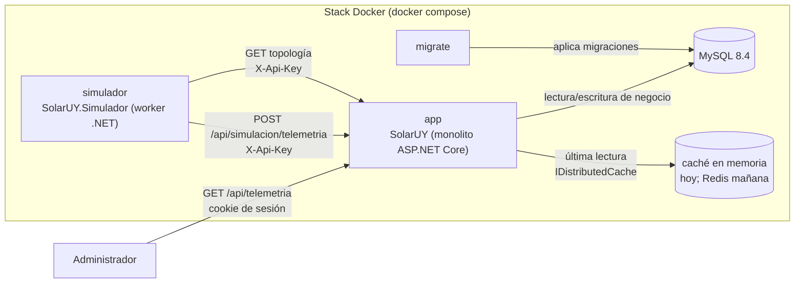

# Especificación Técnica: Simulación de telemetría y sensores ARM (mock del inversor)

## Objetivo

Implementar el mock del inversor como un componente separado del monolito: un proceso y contenedor propios (`simulador`) que obtiene la topología registrada mediante un endpoint interno de SolarUY, genera cada 5 segundos una lectura de telemetría (potencia en W, energía acumulada en kWh y estado de cada panel) y la envía por HTTP a la aplicación, que la valida y conserva en una caché distribuida para exponerla mediante `GET /api/telemetria` al rol Administrador, sin persistencia y sin migraciones.

## Decisiones y supuestos

- Punto de partida: el repositorio **no contiene** código de telemetría. Todo lo descrito en esta spec es nuevo: Dominio, DTOs, servicios, controladores, el proyecto `SolarUY.Simulador`, el servicio Docker y los tests de Dominio. No se elimina ni se reemplaza nada existente.
- El mock es un **componente separado**, no un `BackgroundService` del monolito. Se implementa en un proyecto nuevo, `SolarUY.Simulador`, y se despliega como el servicio `simulador` de `docker-compose.yml`. Es un componente desplegable, no una capa: el monolito sigue siendo un único proyecto en capas.
- La aplicación no genera telemetría. Expone la topología, recibe, valida, conserva y publica la última lectura.
- **La aplicación es la única que accede a MySQL.** El simulador no tiene cadena de conexión, `DbContext` ni repositorios.
- **El simulador no referencia `SolarUY.csproj`.** Se verificó con un prototipo que la referencia de proyecto (a) rompe `dotnet publish` con `NETSDK1152` por el `appsettings.json` duplicado y (b) copia al simulador el `appsettings.Development.json` del monolito, que contiene la cadena de conexión a MySQL, además de arrastrar EF Core, el proveedor MySQL y ASP.NET Core. En su lugar, el simulador compila por enlace (`<Compile Include>`) únicamente los fuentes que comparte con el monolito: el Dominio (C# puro, garantizado por ArchUnitNET), los DTOs de telemetría y topología y `AutenticacionComponentes`. Con esto el simulador corre sobre `Microsoft.NETCore.App` (imagen `runtime`, no `aspnet`).
- La topología se obtiene con `GET /api/simulacion/topologia`, un endpoint interno autenticado con API key. Devuelve parques, nodos con su estado, potencia nominal del inversor y paneles en modo solo lectura.
- La telemetría se envía con `POST /api/simulacion/telemetria`, autenticado con la misma API key.
- El simulador usa una única URL base (`SimulacionApi:UrlBase`): hoy `http://app:8080`, mañana la del balanceador. No conoce hosts individuales ni réplicas.
- La última lectura vive detrás de `IAlmacenTelemetria`, una interfaz **asíncrona** sobre `IDistributedCache`. Hoy se registra `AddDistributedMemoryCache()`; mañana se cambia a Redis sin tocar controladores ni simulador.
- La API key es un secreto compartido entre `app` y `simulador`. Se configura por variable de entorno (`SIMULACION_API_KEY`) y no se versiona.
- No se agregan `DbSet`, configuraciones Fluent API, tablas ni migraciones.
- El contrato JSON de `GET /api/telemetria` es el de los DTOs de la sección 2 (camelCase), con `204` antes de la primera lectura y `200` después.
- La consulta es exclusiva del rol `Administrador` con cookie de sesión. Los endpoints internos usan API key, no cookie ni rol de usuario.
- No se implementa balanceador de carga ni réplicas. Hay una instancia de `app` y una de `simulador`, y la comunicación es directa.
- El simulador envía una lectura aunque no haya parques: la aplicación la almacena como lectura vacía (`fechaHora: null`, `parques: []`) y el `GET` responde `200`.
- Si la topología no se puede obtener, el simulador **no envía** una lectura vacía: omite el tick y conserva la última lectura de la aplicación.
- La energía acumulada se mantiene **sin redondear** en el Dominio y en el estado del simulador, y se redondea a 4 decimales solo al armar el DTO. Redondear el acumulado en cada tick introduciría un error sistemático: con ticks de 5 s un nodo de 0,3 kW suma 0,0004 kWh por tick y nunca superaría el umbral de 0,0005 de un redondeo a 3 decimales.
- La zona horaria es un desfase fijo (`DesfaseHorarioUruguayHoras = -3`): Uruguay no aplica horario de verano y se evita depender de tzdata en el contenedor.
- La verificación manual se realiza con `GET /api/telemetria`, los endpoints internos y los logs de `simulador` y `app`.

## Arquitectura de componentes



Es el flujo "Mock Inversores / Sensores ARM → Envía telemetría → Aplicación monolítica" del diagrama de arquitectura de la Iteración 1.

| Componente | Proyecto / servicio | Responsabilidad |
|---|---|---|
| Aplicación monolítica | `SolarUY` / `app` | ABM de negocio, topología interna, ingesta de telemetría y consulta autenticada |
| Simulador | `SolarUY.Simulador` / `simulador` | Obtener topología, generar lecturas y enviarlas a la aplicación |
| Base de datos | `mysql` | Topología y datos de negocio; no almacena telemetría |
| Migraciones | `migrate` | Aplicar el esquema antes de arrancar `app` |
| Caché de telemetría | `IDistributedCache` | Última lectura efímera; en esta iteración, memoria del proceso `app` |

### Flujo de un tick

1. El `SimuladorTelemetriaHostedService` despierta cada `Simulador:IntervaloSegundos`.
2. `SimuladorInversor` pide la topología a `ClienteTopologia` (`GET /api/simulacion/topologia` con `X-Api-Key`).
3. La aplicación autentica la API key, lee la topología con los repositorios existentes y responde `TopologiaSimulacionDto`.
4. `SimuladorInversor` filtra los nodos `Activo`, sincroniza su estado en memoria de fallas y energía y construye una `LecturaParqueSolarSimulado` por parque (Dominio).
5. `TelemetriaMapper` convierte las lecturas de Dominio en `TelemetriaDto`.
6. `ClienteTelemetria` hace `POST /api/simulacion/telemetria` con JSON y `X-Api-Key`.
7. La aplicación autentica la API key, valida el payload y reemplaza la última lectura de `IAlmacenTelemetria`.
8. `GET /api/telemetria` devuelve esa última lectura a un usuario con rol `Administrador`.

Si la topología falla, el tick se omite y se registra una advertencia. Si el envío falla, el simulador reintenta según `Simulador:IntentosEnvio`; si se agotan los intentos, registra el error y continúa con el siguiente tick. Un fallo del simulador no detiene la aplicación, y un fallo de la aplicación no detiene al simulador.

## 1) Dominio (`SolarUY.Domain`)

Código nuevo en `SolarUY/Domain/Telemetria/` (namespace `SolarUY.Domain.Telemetria`). Es C# puro: no referencia EF Core, ASP.NET Core, `Application`, `Infrastructure` ni `Controllers`. Lo consume el simulador (por enlace de fuentes) y lo prueban los tests de Dominio. La aplicación no lo usa en tiempo de ejecución.

### Entidades y objetos de simulación

#### `EstadoPanelSimulado` (enum)

| Valor | Significado |
|---|---|
| `Operativo` | El panel genera según la curva solar. |
| `EnFalla` | El panel no genera (0 W) hasta recuperarse. |

#### `GeneradorGeneracionSolar` (clase estática)

| Miembro | Firma | Regla |
|---|---|---|
| `HoraInicioGeneracion` | `public const int HoraInicioGeneracion = 7` | Inicio de la ventana solar. |
| `HoraFinGeneracion` | `public const int HoraFinGeneracion = 19` | Fin de la ventana solar. |
| `CalcularFactorSolar` | `public static decimal CalcularFactorSolar(DateTime horaLocal)` | Con `hora = horaLocal.TimeOfDay.TotalHours` (fraccionaria): devuelve 0 si `hora < 7` o `hora >= 19`; en caso contrario devuelve `sin(π × (hora - 7) / 12)` redondeado a 4 decimales y acotado a [0, 1]. El pico (1) es a las 13:00. |
| `CalcularPotenciaGenerada` | `public static decimal CalcularPotenciaGenerada(decimal potenciaWp, DateTime horaLocal, decimal variacion, EstadoPanelSimulado estado)` | Valida `potenciaWp > 0` y `variacion` en [-1, 1]. Devuelve 0 si `estado == EnFalla`. En caso contrario: `factor = CalcularFactorSolar(horaLocal) × (1 + variacion)` acotado a [0, 1]; `potencia = potenciaWp × factor` redondeada a 2 decimales (`MidpointRounding.AwayFromZero`) y acotada a [0, `potenciaWp`] **después** de redondear. |

#### `PanelSimulado`

Representa el estado en memoria de un panel durante la simulación. No se persiste.

| Campo | Tipo | Regla |
|---|---|---|
| `PanelId` | `Guid` | Obligatorio, no vacío, inmutable. |
| `NodoId` | `Guid` | Obligatorio, no vacío, inmutable. |
| `CodigoSerie` | `string` | Obligatorio, trim, máximo `Panel.CodigoSerieMaxLength`. |
| `PotenciaWp` | `decimal` | Obligatoria, mayor a 0. |
| `Estado` | `EstadoPanelSimulado` | Inicia en `Operativo`; solo cambia mediante `ActualizarEstado`. |
| `TicksRestantesFalla` | `int` | Inicia en 0; mayor o igual a 0. |

Comportamiento:

- Constructor `PanelSimulado(Guid panelId, Guid nodoId, string codigoSerie, decimal potenciaWp)` con las validaciones indicadas.
- `ActualizarEstado(decimal probabilidadFalla, int duracionFallaTicks, decimal valorAleatorio)`:
  - Valida `probabilidadFalla` en [0, 1], `duracionFallaTicks > 0` y `valorAleatorio` en [0, 1].
  - Si `Estado == EnFalla`: descuenta un tick en `TicksRestantesFalla`; cuando llega a 0, cambia a `Operativo`.
  - **En caso contrario** (`Estado == Operativo`): si `valorAleatorio < probabilidadFalla`, cambia a `EnFalla` y asigna `TicksRestantesFalla = duracionFallaTicks`.
  - Las dos ramas son excluyentes: un panel que se recupera en una lectura no vuelve a fallar en esa misma lectura.
  - Con `duracionFallaTicks = N`, el panel informa exactamente N lecturas `EnFalla` consecutivas (la del tick en que falla y las N-1 siguientes) y la lectura N+1 es `Operativo`.
- `GenerarLectura(DateTime horaLocal, decimal variacion, DateTime fechaHoraUtc)`:
  - Invoca `GeneradorGeneracionSolar.CalcularPotenciaGenerada(PotenciaWp, horaLocal, variacion, Estado)`.
  - Devuelve un `LecturaPanelSimulado` con `PanelId`, `CodigoSerie`, la potencia calculada, el `Estado` actual y `fechaHoraUtc`.

#### `LecturaPanelSimulado`

| Campo | Tipo | Regla |
|---|---|---|
| `PanelId` | `Guid` | Obligatorio, no vacío. |
| `CodigoSerie` | `string` | Obligatorio, trim, máximo `Panel.CodigoSerieMaxLength`. |
| `PotenciaGeneradaW` | `decimal` | Mayor o igual a 0. |
| `Estado` | `EstadoPanelSimulado` | Obligatorio. |
| `FechaHora` | `DateTime` | Obligatoria, distinta de `default`. |

- Constructor `LecturaPanelSimulado(Guid panelId, string codigoSerie, decimal potenciaGeneradaW, EstadoPanelSimulado estado, DateTime fechaHoraUtc)`.
- Propiedad calculada `EstaOperativo => Estado == EstadoPanelSimulado.Operativo`.

#### `LecturaNodoSimulado`

| Campo | Tipo | Regla |
|---|---|---|
| `NodoId` | `Guid` | Obligatorio, no vacío. |
| `CodigoNodo` | `string` | Obligatorio, trim, máximo `Nodo.CodigoMaxLength`. |
| `PotenciaGeneradaW` | `decimal` | Suma de los paneles, limitada por la potencia máxima cuando se informa. |
| `EnergiaAcumuladaKWh` | `decimal` | Energía anterior más la generada en el intervalo, **sin redondear**. |
| `FechaHora` | `DateTime` | Obligatoria, distinta de `default`. |
| `Paneles` | `IReadOnlyList<LecturaPanelSimulado>` | Lista inmutable; puede estar vacía. |

Factory:

```csharp
public static LecturaNodoSimulado Crear(
    Guid nodoId,
    string codigoNodo,
    IReadOnlyList<LecturaPanelSimulado> paneles,
    decimal energiaAcumuladaAnteriorKWh,
    decimal? potenciaMaximaKW,
    TimeSpan intervalo,
    DateTime fechaHoraUtc)
```

Reglas de la factory:

- Valida `nodoId` no vacío, `codigoNodo` obligatorio y con longitud máxima, `paneles` no nulo, `energiaAcumuladaAnteriorKWh >= 0`, `intervalo > TimeSpan.Zero` y `fechaHoraUtc` distinta de `default`.
- Si `potenciaMaximaKW` tiene valor, debe ser **mayor o igual a 0**. Es el mismo rango que acepta `Inversor.PotenciaNominalkW` (que permite 0); exigir `> 0` haría fallar todo el tick ante un inversor registrado con 0 kW.
- `PotenciaGeneradaW = min(suma de paneles, potenciaMaximaKW × 1000)`; si `potenciaMaximaKW` es `null`, no aplica límite.
- `EnergiaAcumuladaKWh = energiaAcumuladaAnteriorKWh + (PotenciaGeneradaW / 1000) × (decimal)intervalo.TotalSeconds / 3600`.

#### `LecturaParqueSolarSimulado`

| Campo | Tipo | Regla |
|---|---|---|
| `ParqueSolarId` | `Guid` | Obligatorio, no vacío. |
| `NombreParque` | `string` | Obligatorio, trim, máximo `ParqueSolar.NombreMaxLength`. |
| `PotenciaGeneradaW` | `decimal` | Suma de la potencia de los nodos. |
| `EnergiaAcumuladaKWh` | `decimal` | Suma de la energía acumulada de los nodos, sin redondear. |
| `FechaHora` | `DateTime` | Obligatoria, distinta de `default`. |
| `Nodos` | `IReadOnlyList<LecturaNodoSimulado>` | Lista inmutable; puede estar vacía. |

Factory:

```csharp
public static LecturaParqueSolarSimulado Crear(
    Guid parqueSolarId,
    string nombreParque,
    IReadOnlyList<LecturaNodoSimulado> nodos,
    DateTime fechaHoraUtc)
```

Reglas de la factory:

- Valida `parqueSolarId` no vacío, `nombreParque` obligatorio y con longitud máxima, `nodos` no nulo y `fechaHoraUtc` distinta de `default`.
- `PotenciaGeneradaW = suma de la potencia de los nodos`.
- `EnergiaAcumuladaKWh = suma de la energía acumulada de los nodos`.

### Validaciones

- Todos los identificadores `Guid` deben ser distintos de `Guid.Empty`.
- Todos los textos obligatorios se normalizan con `Trim` y no pueden quedar vacíos.
- Las longitudes máximas reutilizan las constantes existentes: `Panel.CodigoSerieMaxLength`, `Nodo.CodigoMaxLength` y `ParqueSolar.NombreMaxLength`.
- Las potencias generadas y las energías acumuladas no pueden ser negativas.
- La potencia de un panel no puede superar su `PotenciaWp`.
- La energía acumulada se calcula en el Dominio; el simulador solo aporta el intervalo, la energía anterior y los valores aleatorios.
- Las validaciones lanzan `ArgumentException`, `ArgumentNullException` o `ArgumentOutOfRangeException` con mensajes en español, igual que `Panel` y `Nodo`.

### Excepciones

No se crean excepciones nuevas: se usan las de argumentos de .NET, como en las entidades existentes.

### Repositorios (contratos)

No se agregan ni modifican contratos de repositorio.

## 2) Aplicación (`SolarUY.Application`)

### DTOs de telemetría

Ubicación: `SolarUY/Application/Dtos/` (namespace `SolarUY.Application.Dtos`, clases con propiedades `get; set;` como el resto de los DTOs). Son el contrato de salida de `GET /api/telemetria` y de entrada de `POST /api/simulacion/telemetria`.

| DTO | Propiedades |
|---|---|
| `TelemetriaDto` | `DateTime? FechaHora`, `IReadOnlyList<TelemetriaParqueSolarDto> Parques` |
| `TelemetriaParqueSolarDto` | `Guid ParqueSolarId`, `string NombreParque`, `decimal PotenciaGeneradaW`, `decimal EnergiaAcumuladaKWh`, `DateTime FechaHora`, `IReadOnlyList<TelemetriaNodoDto> Nodos` |
| `TelemetriaNodoDto` | `Guid NodoId`, `string CodigoNodo`, `decimal PotenciaGeneradaW`, `decimal EnergiaAcumuladaKWh`, `DateTime FechaHora`, `IReadOnlyList<TelemetriaPanelDto> Paneles` |
| `TelemetriaPanelDto` | `Guid PanelId`, `string CodigoSerie`, `decimal PotenciaGeneradaW`, `string Estado`, `DateTime FechaHora` |

- `Estado` se serializa con el nombre del enum: `Operativo` o `EnFalla`.
- `TelemetriaDto.FechaHora` es `null` cuando la lectura no contiene parques.
- Los DTOs no llevan DataAnnotations ni `[JsonRequired]`; la ingesta valida con `ValidadorTelemetria`.
- Ejemplo de respuesta:

```json
{
  "fechaHora": "2026-11-05T16:00:05Z",
  "parques": [
    {
      "parqueSolarId": "…",
      "nombreParque": "Parque Norte",
      "potenciaGeneradaW": 400.0,
      "energiaAcumuladaKWh": 0.0056,
      "fechaHora": "2026-11-05T16:00:05Z",
      "nodos": [
        {
          "nodoId": "…",
          "codigoNodo": "N-01",
          "potenciaGeneradaW": 400.0,
          "energiaAcumuladaKWh": 0.0056,
          "fechaHora": "2026-11-05T16:00:05Z",
          "paneles": [
            { "panelId": "…", "codigoSerie": "PAN-001", "potenciaGeneradaW": 400.0, "estado": "Operativo", "fechaHora": "2026-11-05T16:00:05Z" }
          ]
        }
      ]
    }
  ]
}
```

### DTOs de topología

Ubicación: `SolarUY/Application/Dtos/`.

| DTO | Propiedades |
|---|---|
| `TopologiaSimulacionDto` | `IReadOnlyList<ParqueSimulacionDto> Parques` |
| `ParqueSimulacionDto` | `Guid ParqueSolarId`, `string NombreParque`, `IReadOnlyList<NodoSimulacionDto> Nodos` |
| `NodoSimulacionDto` | `Guid NodoId`, `string CodigoNodo`, `string Estado`, `decimal? PotenciaNominalInversorKW`, `IReadOnlyList<PanelSimulacionDto> Paneles` |
| `PanelSimulacionDto` | `Guid PanelId`, `string CodigoSerie`, `decimal PotenciaWp` |

- Los DTOs son de solo lectura y no tienen lógica de negocio.
- `Estado` conserva el texto registrado en la entidad (`Activo`, `EnMantenimiento`, etc.; es texto libre en `Nodo`); el simulador decide qué nodos simular.
- `PotenciaNominalInversorKW` se toma de `Nodo.Inversor.PotenciaNominalkW` y es `null` cuando el inversor no la informa.
- La topología incluye todos los parques y todos sus nodos, con sus paneles, para que el simulador aplique las reglas de simulación.
- La serialización usa el comportamiento web por defecto de ASP.NET Core (camelCase).

### `AutenticacionComponentes`

Ubicación: `SolarUY/Application/Seguridad/AutenticacionComponentes.cs`.

```csharp
public static class AutenticacionComponentes
{
    public const string EsquemaApiKey = "ApiKey";
    public const string EncabezadoApiKey = "X-Api-Key";
}
```

- Centraliza los nombres del esquema y del encabezado para que la Presentación no dependa de Infraestructura.
- Los usan el controlador, el handler de autenticación y los clientes del simulador (que compilan este archivo por enlace).

### `IAlmacenTelemetria`

Ubicación: `SolarUY/Application/Services/IAlmacenTelemetria.cs`.

```csharp
Task<TelemetriaDto?> ObtenerAsync(CancellationToken cancellationToken = default);

Task GuardarAsync(TelemetriaDto lectura, CancellationToken cancellationToken = default);
```

- `ObtenerAsync` devuelve `null` si todavía no se recibió ninguna lectura o si la entrada expiró.
- `GuardarAsync` reemplaza la lectura anterior; la última escritura gana.
- La interfaz es asíncrona desde ahora para que el cambio a Redis sea solo de registro de dependencias.
- La implementación concreta vive en Infraestructura.

### `ITelemetriaService` / `TelemetriaService`

Ubicación: `SolarUY/Application/Services/`.

```csharp
public interface ITelemetriaService
{
    Task<TelemetriaDto?> ObtenerUltimaLecturaAsync(CancellationToken cancellationToken = default);

    Task<ResultadoIngestaTelemetria> RegistrarLecturaAsync(
        TelemetriaDto? lectura,
        CancellationToken cancellationToken = default);
}

public sealed record ResultadoIngestaTelemetria(
    bool EsValida,
    IReadOnlyList<string> Errores);
```

Reglas:

- Depende de `IAlmacenTelemetria`, `ValidadorTelemetria` e `ILogger<TelemetriaService>`.
- `ObtenerUltimaLecturaAsync` delega en `IAlmacenTelemetria.ObtenerAsync`.
- `RegistrarLecturaAsync` valida con `ValidadorTelemetria`. Si hay errores, registra una advertencia con la cantidad de errores y el primero, devuelve `EsValida = false` y no modifica el almacén. Si es válida, llama a `GuardarAsync`, registra una línea informativa (fecha/hora y cantidad de parques) y devuelve `EsValida = true` con lista de errores vacía.
- El servicio no tiene estado propio y no accede a repositorios ni a `DbContext`; no usa `DateTime.Now`.
- Se registra como singleton porque solo depende del almacén singleton, del validador stateless y del logger.

### `ITopologiaSimulacionService` / `TopologiaSimulacionService`

Ubicación: `SolarUY/Application/Services/`.

```csharp
public interface ITopologiaSimulacionService
{
    Task<TopologiaSimulacionDto> ObtenerAsync(CancellationToken cancellationToken = default);
}
```

Reglas:

- Depende de `IParqueSolarRepository`, `INodoRepository` e `IPanelRepository`.
- Obtiene todos los parques con `ObtenerTodosAsync`.
- Por cada parque, obtiene sus nodos con `ObtenerPorParqueAsync` (que ya incluye el `Inversor`) y, por cada nodo, sus paneles con `ObtenerPorNodoAsync`.
- Mapea las entidades a `TopologiaSimulacionDto`, conservando el orden devuelto por los repositorios.
- No filtra nodos por estado: la topología es un reflejo de lo registrado y el simulador aplica la regla de simular solo nodos `Activo`.
- No escribe en la base de datos, no usa `DbContext` y no conoce al simulador.
- Se registra como scoped porque depende de repositorios scoped.
- La implementación hace una consulta por nodo (N+1). Es aceptable para la prueba de concepto y no requiere métodos nuevos de repositorio.

### `ValidadorTelemetria`

Ubicación: `SolarUY/Application/Services/ValidadorTelemetria.cs`.

```csharp
public IReadOnlyList<string> Validar(TelemetriaDto? lectura);
```

Reglas:

- Si `lectura` es `null`, devuelve `["La lectura es obligatoria."]`.
- Si `Parques` es `null`, devuelve `["La lista de parques es obligatoria."]`.
- Si `Parques` está vacía, `FechaHora` debe ser `null`; en caso contrario devuelve un error.
- Si `Parques` tiene elementos, `FechaHora` no puede ser `null` ni `default`.
- Por cada parque:
  - `ParqueSolarId != Guid.Empty`;
  - `NombreParque` no vacío y con longitud máxima `ParqueSolar.NombreMaxLength`;
  - `PotenciaGeneradaW >= 0` y `EnergiaAcumuladaKWh >= 0`;
  - `FechaHora != default`;
  - `Nodos` no nulo.
- Por cada nodo:
  - `NodoId != Guid.Empty`;
  - `CodigoNodo` no vacío y con longitud máxima `Nodo.CodigoMaxLength`;
  - `PotenciaGeneradaW >= 0` y `EnergiaAcumuladaKWh >= 0`;
  - `FechaHora != default`;
  - `Paneles` no nulo.
- Por cada panel:
  - `PanelId != Guid.Empty`;
  - `CodigoSerie` no vacío y con longitud máxima `Panel.CodigoSerieMaxLength`;
  - `PotenciaGeneradaW >= 0`;
  - `Estado` es exactamente (sensible a mayúsculas) uno de los nombres de `EstadoPanelSimulado`: `Operativo` o `EnFalla`;
  - `FechaHora != default`.
- Los mensajes indican la ruta del dato inválido, por ejemplo `"parques[0].nodos[1].potenciaGeneradaW no puede ser negativa."`.
- No se validan las sumas de potencia ni de energía: el emisor es un componente interno confiable y las fórmulas viven en el Dominio.
- El validador es stateless y se registra como singleton.

### `IValidadorApiKey`

Ubicación: `SolarUY/Application/Services/IValidadorApiKey.cs`.

```csharp
bool EsValida(string? apiKey);
```

## 3) Infraestructura (`SolarUY.Infrastructure`)

### DbSet y configuraciones

No se agregan `DbSet`, configuraciones Fluent API ni propiedades de navegación.

### `AlmacenTelemetriaCache`

Ubicación: `SolarUY/Infrastructure/Telemetria/AlmacenTelemetriaCache.cs`.

- Implementa `IAlmacenTelemetria` y se registra como **singleton**.
- Depende de `IDistributedCache` e `IOptions<ConfiguracionAlmacenTelemetria>`.
- Serializa y deserializa `TelemetriaDto` con `JsonSerializerOptions(JsonSerializerDefaults.Web)` para conservar el contrato camelCase y las fechas UTC.
- `ObtenerAsync`:
  - lee la clave configurada con `GetAsync`;
  - si no hay entrada o está vacía, devuelve `null`;
  - deserializa el `byte[]` a `TelemetriaDto`.
- `GuardarAsync`:
  - valida que `lectura` no sea `null` con `ArgumentNullException.ThrowIfNull`;
  - serializa con `SerializeToUtf8Bytes`;
  - escribe con `SetAsync` y `DistributedCacheEntryOptions.AbsoluteExpirationRelativeToNow = TimeSpan.FromHours(VigenciaHoras)`.
- No usa `DbContext`, archivos ni base de datos.
- No captura excepciones de la caché: un fallo de Redis o de serialización se registra en el pipeline y el simulador reintenta el envío. No se devuelve una lectura vacía silenciosamente.
- Clave por defecto: `simulacion:ultima-telemetria`.
- La escritura no es atómica entre réplicas concurrentes; con un único simulador la última escritura gana. La concurrencia real se resuelve cuando se agregue el balanceador.

### `ConfiguracionAlmacenTelemetria`

Ubicación: `SolarUY/Infrastructure/Telemetria/ConfiguracionAlmacenTelemetria.cs`.

```csharp
public const string Seccion = "TelemetriaAlmacen";

public string Clave { get; set; } = "simulacion:ultima-telemetria";

public int VigenciaHoras { get; set; } = 24;
```

- Se enlaza desde la sección `TelemetriaAlmacen` de `appsettings.json`.
- El constructor de `AlmacenTelemetriaCache` valida que `Clave` no esté vacía y que `VigenciaHoras > 0`; una configuración inválida detiene el arranque con `InvalidOperationException`.

### `ConfiguracionApiSimulacion`

Ubicación: `SolarUY/Infrastructure/Telemetria/ConfiguracionApiSimulacion.cs`.

```csharp
public const string Seccion = "SimulacionApi";

public string ApiKey { get; set; } = string.Empty;
```

- Se enlaza desde la sección `SimulacionApi` de `appsettings.json`.
- La aplicación no necesita `UrlBase`; solo la key para autenticar los endpoints internos.
- La key no se escribe en logs ni se devuelve en respuestas.
- Si está vacía, la aplicación arranca, registra una advertencia (ver `Program.cs`) y rechaza toda petición interna con `401`.

### `ValidadorApiKey`

Ubicación: `SolarUY/Infrastructure/Telemetria/ValidadorApiKey.cs`. Implementa `IValidadorApiKey` y depende de `IOptions<ConfiguracionApiSimulacion>`.

- Devuelve `false` si la key configurada está vacía.
- Devuelve `false` si `apiKey` es `null` o vacía.
- Compara los bytes UTF-8 con `CryptographicOperations.FixedTimeEquals` para evitar comparaciones de tiempo variable (con longitudes distintas devuelve `false`).
- No registra la key recibida.
- Se registra como singleton.

### `ApiKeyAuthenticationHandler`

Ubicación: `SolarUY/Infrastructure/Telemetria/ApiKeyAuthenticationHandler.cs`.

- Hereda de `AuthenticationHandler<AuthenticationSchemeOptions>`.
- Usa `AutenticacionComponentes.EsquemaApiKey` y `AutenticacionComponentes.EncabezadoApiKey`; no redefine literales.
- Depende de `IValidadorApiKey`, además de las dependencias habituales del handler.
- `HandleAuthenticateAsync` lee `Request.Headers[AutenticacionComponentes.EncabezadoApiKey]`:
  - si `EsValida` devuelve `false`, retorna `AuthenticateResult.Fail("API key inválida.")`;
  - si es válida, crea un `ClaimsPrincipal` con `ClaimTypes.Name = "simulador"` y el claim `componente = "simulador"`, sin roles, y devuelve `AuthenticateResult.Success`.
- Al no usar cookie, un fallo de autenticación devuelve `401` y no redirige al login.

### Migración

**No hay cambios de esquema y no se genera ninguna migración.** La telemetría es efímera y vive en la caché distribuida; la topología se lee de las tablas existentes (`ParquesSolares`, `Nodos`, `Inversores`, `Paneles`) sin modificarlas.

### Registro de dependencias (`Program.cs`)

```csharp
builder.Services.AddDistributedMemoryCache();

builder.Services.Configure<ConfiguracionAlmacenTelemetria>(
    builder.Configuration.GetSection(ConfiguracionAlmacenTelemetria.Seccion));
builder.Services.Configure<ConfiguracionApiSimulacion>(
    builder.Configuration.GetSection(ConfiguracionApiSimulacion.Seccion));

builder.Services.AddSingleton<IAlmacenTelemetria, AlmacenTelemetriaCache>();
builder.Services.AddSingleton<IValidadorApiKey, ValidadorApiKey>();
builder.Services.AddSingleton<ValidadorTelemetria>();
builder.Services.AddSingleton<ITelemetriaService, TelemetriaService>();
builder.Services.AddScoped<ITopologiaSimulacionService, TopologiaSimulacionService>();

builder.Services
    .AddAuthentication(CookieAuthenticationDefaults.AuthenticationScheme)
    .AddCookie(options =>
    {
        options.LoginPath = "/dev/login";
        options.LogoutPath = "/dev/logout";
        options.AccessDeniedPath = "/dev/denegado";
        options.ExpireTimeSpan = TimeSpan.FromHours(8);
        options.SlidingExpiration = true;
    })
    .AddScheme<AuthenticationSchemeOptions, ApiKeyAuthenticationHandler>(
        AutenticacionComponentes.EsquemaApiKey,
        null);
```

Después de `builder.Build()`:

```csharp
if (string.IsNullOrWhiteSpace(app.Configuration[$"{ConfiguracionApiSimulacion.Seccion}:ApiKey"]))
{
    app.Logger.LogWarning(
        "SimulacionApi:ApiKey no está configurada: /api/simulacion/* responderá 401.");
}
```

- Solo se **agregan** registros al `Program.cs` actual (la cadena de `AddAuthentication().AddCookie(...)` ya existe y se le encadena `AddScheme`).
- El esquema de cookie sigue siendo el predeterminado; el esquema `ApiKey` se usa solo en `SimulacionController`.
- `AddDistributedMemoryCache()` es la única línea que cambia cuando se incorpore Redis.

### Configuración en `appsettings.json`

Se agrega a `SolarUY/appsettings.json`:

```json
"SimulacionApi": {
  "ApiKey": ""
},
"TelemetriaAlmacen": {
  "Clave": "simulacion:ultima-telemetria",
  "VigenciaHoras": 24
}
```

La key real se inyecta por variable de entorno en Docker; no se versiona.

## 4) Presentación (`SolarUY.Controllers`)

### Controlador y acciones

#### `SimulacionController`

Ubicación: `SolarUY/Controllers/SimulacionController.cs`.

```csharp
[ApiController]
[Route("api/simulacion")]
[Authorize(AuthenticationSchemes = AutenticacionComponentes.EsquemaApiKey)]
public class SimulacionController : ControllerBase
{
    [HttpGet("topologia")]
    public Task<IActionResult> ObtenerTopologia(CancellationToken cancellationToken);

    [HttpPost("telemetria")]
    public Task<IActionResult> RecibirTelemetria(
        [FromBody] TelemetriaDto? lectura,
        CancellationToken cancellationToken);
}
```

- Inyecta `ITopologiaSimulacionService` y `ITelemetriaService`.
- `ObtenerTopologia` responde `200 OK` con `TopologiaSimulacionDto`, incluso si no hay parques (`{ "parques": [] }`).
- `RecibirTelemetria`:
  - llama a `RegistrarLecturaAsync`;
  - si `EsValida` es `false`, responde `400 Bad Request` con `{ "errores": [...] }` y no modifica la caché;
  - si es válida, responde `204 No Content`.
- Un JSON malformado o con campos no nulables ausentes también responde `400` (`ProblemDetails` del framework `[ApiController]`) antes de llegar al servicio; el validador cubre el resto de las reglas.
- El controlador no contiene lógica de negocio, no accede a repositorios ni a `DbContext`, y no conoce al simulador.
- El atributo `[Authorize]` a nivel de clase protege ambos endpoints con la API key.

#### `TelemetriaController`

Ubicación: `SolarUY/Controllers/TelemetriaController.cs`.

```csharp
[ApiController]
[Route("api/telemetria")]
[Authorize(Roles = "Administrador")]
public class TelemetriaController : ControllerBase
{
    [HttpGet]
    public Task<IActionResult> ObtenerUltimaLectura(CancellationToken cancellationToken);
}
```

- Inyecta `ITelemetriaService` por constructor.
- Llama a `ObtenerUltimaLecturaAsync`.
- Si el servicio devuelve `null`, responde `204 No Content`; si devuelve un DTO, responde `200 OK` con el JSON.
- No recibe telemetría: la ingesta es exclusiva de `SimulacionController`.

### Autorización

- `GET /api/telemetria`: cookie de sesión y rol `Administrador`. Sin sesión, el middleware de cookies **redirige (`302`) a `/dev/login?ReturnUrl=...`**, igual que el resto de la aplicación (no responde `401`); con sesión sin el rol, redirige a `/dev/denegado`. En `Development`, `/dev/login` firma al Administrador y vuelve a la URL pedida. No se cambia el comportamiento de autenticación (fuera de alcance).
- `GET /api/simulacion/topologia` y `POST /api/simulacion/telemetria`: esquema `ApiKey` y encabezado `X-Api-Key`. Sin encabezado o con key incorrecta, responden `401` sin tocar la lectura almacenada.
- La API key no se acepta por query string ni por body.
- Los endpoints internos no usan anti-forgery porque no se autentican con cookie.
- La consulta es de solo lectura y no permite comandos al inversor.

### Vistas

No se crean vistas Razor ni hubs de SignalR. La verificación se hace con los endpoints JSON y los logs.

## 5) Proyecto simulador (`SolarUY.Simulador`)

Componente separado: no pertenece a las capas del monolito y queda fuera del ensamblado que analiza ArchUnitNET.

### Estructura

```text
SolarUY.Simulador/
├── SolarUY.Simulador.csproj
├── Program.cs
├── appsettings.json
├── Simulacion/
│   ├── ConfiguracionSimulador.cs
│   ├── SimuladorInversor.cs
│   └── SimuladorTelemetriaHostedService.cs
└── Transporte/
    ├── ConfiguracionSimulacionApi.cs
    ├── ClienteTopologia.cs
    ├── ClienteTelemetria.cs
    └── TelemetriaMapper.cs
```

### Proyecto (`SolarUY.Simulador.csproj`)

```xml
<Project Sdk="Microsoft.NET.Sdk.Worker">
  <PropertyGroup>
    <TargetFramework>net10.0</TargetFramework>
    <Nullable>enable</Nullable>
    <ImplicitUsings>enable</ImplicitUsings>
  </PropertyGroup>

  <ItemGroup>
    <PackageReference Include="Microsoft.Extensions.Hosting" Version="10.0.0" />
    <PackageReference Include="Microsoft.Extensions.Http" Version="10.0.0" />
  </ItemGroup>

  <!-- Fuentes compartidas con el monolito (compilación por enlace, sin ProjectReference). -->
  <ItemGroup>
    <Compile Include="..\SolarUY\Domain\**\*.cs" LinkBase="SolarUY\Domain" />
    <Compile Include="..\SolarUY\Application\Dtos\Telemetria*Dto.cs" LinkBase="SolarUY\Application\Dtos" />
    <Compile Include="..\SolarUY\Application\Dtos\*SimulacionDto.cs" LinkBase="SolarUY\Application\Dtos" />
    <Compile Include="..\SolarUY\Application\Seguridad\AutenticacionComponentes.cs" LinkBase="SolarUY\Application\Seguridad" />
  </ItemGroup>
</Project>
```

- `net10.0`, `Nullable` e `ImplicitUsings` habilitados. Se agrega a `SolarUY.sln`.
- **No** tiene `ProjectReference` a `SolarUY.csproj` ni a ningún otro proyecto. Los paquetes son los únicos de la solución para hosting y `AddHttpClient`.
- No referencia controladores, vistas, `DbContext`, repositorios, EF Core ni el pipeline web. Su `Program.cs` es un host de consola.
- No tiene cadena de conexión ni variables de MySQL.
- Los tipos compartidos se compilan en ambos ensamblados; no hay conflicto porque el simulador no referencia el ensamblado `SolarUY`.
- Verificación: `dotnet publish` del simulador solo contiene su propio `appsettings.json` y ninguna DLL de EF Core, MySQL ni ASP.NET Core.

### `ConfiguracionSimulador`

Ubicación: `SolarUY.Simulador/Simulacion/ConfiguracionSimulador.cs`.

```csharp
public const string Seccion = "Simulador";

public int IntervaloSegundos { get; set; } = 5;
public decimal ProbabilidadFalla { get; set; } = 0.05m;
public int DuracionFallaTicks { get; set; } = 6;
public decimal VariacionMaxima { get; set; } = 0.10m;
public int DesfaseHorarioUruguayHoras { get; set; } = -3;
public int IntentosEnvio { get; set; } = 3;
public int EsperaEntreIntentosSegundos { get; set; } = 2;
```

- Se valida al arrancar (ver `Program.cs`): `IntervaloSegundos > 0`, `ProbabilidadFalla` en [0, 1], `DuracionFallaTicks > 0`, `VariacionMaxima` en [0, 1], `DesfaseHorarioUruguayHoras` en [-12, 12], `IntentosEnvio >= 1` y `EsperaEntreIntentosSegundos >= 0`.
- Una configuración inválida detiene el arranque con un mensaje que indica la clave afectada.

### `ConfiguracionSimulacionApi`

Ubicación: `SolarUY.Simulador/Transporte/ConfiguracionSimulacionApi.cs`.

```csharp
public const string Seccion = "SimulacionApi";

public string UrlBase { get; set; } = "http://app:8080";
public string ApiKey { get; set; } = string.Empty;
public int TimeoutSegundos { get; set; } = 10;
```

- `UrlBase` debe ser una URL absoluta HTTP/HTTPS; `ApiKey` no puede estar vacía; `TimeoutSegundos > 0`.
- Una configuración inválida detiene el arranque con un mensaje que indica la clave afectada.

### `ClienteTopologia`

Ubicación: `SolarUY.Simulador/Transporte/ClienteTopologia.cs`.

```csharp
public Task<TopologiaSimulacionDto?> ObtenerAsync(CancellationToken cancellationToken);
```

- Depende de `HttpClient` (tipado), `IOptions<ConfiguracionSimulacionApi>` e `ILogger<ClienteTopologia>`.
- Arma `GET api/simulacion/topologia` sobre la `BaseAddress` y agrega el encabezado `AutenticacionComponentes.EncabezadoApiKey` con la key configurada.
- Deserializa con `JsonSerializerOptions(JsonSerializerDefaults.Web)` y devuelve el DTO para cualquier respuesta `2xx`.
- Para una respuesta no exitosa, registra una advertencia con el código y un fragmento del body, y devuelve `null`.
- Captura `HttpRequestException`, `TaskCanceledException` (incluye el timeout) y `JsonException`, registra una advertencia y devuelve `null`. Si el token de cancelación del servicio está cancelado, relanza la cancelación.
- No registra la API key.
- Un `null` significa "topología no disponible"; el hosted service omite el tick y no envía telemetría.

### `SimuladorInversor`

Ubicación: `SolarUY.Simulador/Simulacion/SimuladorInversor.cs`.

- Se registra como **singleton**. Es una clase del simulador, sin interfaz de la aplicación.
- Dependencias: `ClienteTopologia`, `IOptions<ConfiguracionSimulador>`, `TimeProvider` e `ILogger<SimuladorInversor>`.
- Estado en memoria:
  - `Dictionary<Guid, PanelSimulado> _panelesPorId`;
  - `Dictionary<Guid, decimal> _energiaAcumuladaPorNodo`.
- `GenerarLecturaAsync(CancellationToken)` devuelve `IReadOnlyList<LecturaParqueSolarSimulado>?`:
  1. Obtiene la topología con `ClienteTopologia`. Si devuelve `null`, devuelve `null` y no modifica su estado.
  2. Toma `fechaHoraUtc = _tiempo.GetUtcNow().UtcDateTime` y calcula `horaLocal = fechaHoraUtc.AddHours(DesfaseHorarioUruguayHoras)`.
  3. Recorre los parques de la topología. Para cada nodo, registra su id en `nodosEnTopologia`.
  4. Descarta los nodos cuyo `Estado` no sea `Activo` (`StringComparison.OrdinalIgnoreCase`).
  5. Por cada nodo activo, sincroniza `_panelesPorId` con sus paneles: agrega los nuevos, elimina los que ya no existen y **reemplaza por un `PanelSimulado` nuevo** (perdiendo su estado de falla) a los que cambiaron su `CodigoSerie` o su `PotenciaWp`, para que nunca se supere la potencia registrada. Los demás conservan estado y ticks de falla.
  6. Por cada panel genera `valorFalla` y `variacion` con `Random.Shared` (`variacion` en [-`VariacionMaxima`, `VariacionMaxima`]), invoca `ActualizarEstado` y `GenerarLectura`.
  7. Construye las lecturas de nodo con `LecturaNodoSimulado.Crear`, usando la energía anterior, `PotenciaNominalInversorKW` y `TimeSpan.FromSeconds(IntervaloSegundos)`.
  8. Construye las lecturas de parque con `LecturaParqueSolarSimulado.Crear`.
  9. Elimina de `_panelesPorId` los paneles que ya no están en nodos activos y de `_energiaAcumuladaPorNodo` los nodos que ya no están en la topología. La energía de un nodo inactivo pero todavía registrado se conserva para cuando vuelva a estar activo.
  10. Devuelve la lista de lecturas (puede ser vacía si no hay parques).
- Si la topología tiene parques pero ningún nodo activo, devuelve una lectura por parque con `0 W`, `nodos: []` y energía 0.
- Si una excepción de Dominio impide construir una lectura, se propaga al hosted service, que registra el error y omite el tick.
- No guarda una "última lectura" ni conoce HTTP salvo por `ClienteTopologia`: solo genera.
- No escribe en la base de datos ni conoce MySQL.

### `TelemetriaMapper`

Ubicación: `SolarUY.Simulador/Transporte/TelemetriaMapper.cs`.

```csharp
public static TelemetriaDto Mapear(IReadOnlyList<LecturaParqueSolarSimulado> lecturas)
```

- Valida que `lecturas` no sea `null`.
- Si la lista está vacía, devuelve `TelemetriaDto` con `FechaHora = null` y `Parques` vacía.
- Si hay lecturas, `FechaHora` toma la fecha/hora de la primera y `Parques` se mapea en el mismo orden, incluyendo nodos y paneles.
- `Estado` de panel = `Estado.ToString()` (`Operativo` o `EnFalla`).
- Redondea `EnergiaAcumuladaKWh` de nodo y de parque a 4 decimales (`MidpointRounding.AwayFromZero`); la potencia ya viene redondeada a 2 decimales desde el Dominio. Por el redondeo, la energía del parque puede diferir de la suma de las de sus nodos hasta en 0,0001 kWh por nodo.
- El mapeo es manual; no se agrega AutoMapper. Vive en el simulador porque es el único que lo usa.

### `ClienteTelemetria`

Ubicación: `SolarUY.Simulador/Transporte/ClienteTelemetria.cs`.

```csharp
public Task<bool> EnviarAsync(TelemetriaDto lectura, CancellationToken cancellationToken);
```

- Depende de `HttpClient` (tipado), `IOptions<ConfiguracionSimulacionApi>` e `ILogger<ClienteTelemetria>`.
- `EnviarAsync`:
  - arma `POST api/simulacion/telemetria` sobre la `BaseAddress`;
  - agrega el encabezado `AutenticacionComponentes.EncabezadoApiKey` con la key configurada;
  - serializa `TelemetriaDto` como JSON (`application/json`, opciones web);
  - devuelve `true` para cualquier respuesta `2xx`;
  - para una respuesta no exitosa, registra una advertencia con el código y un fragmento del body, y devuelve `false`;
  - captura `HttpRequestException` y `TaskCanceledException` (incluye el timeout), registra una advertencia y devuelve `false`; si el token de cancelación del servicio está cancelado, relanza la cancelación;
  - no registra la API key.

### `SimuladorTelemetriaHostedService`

Ubicación: `SolarUY.Simulador/Simulacion/SimuladorTelemetriaHostedService.cs`.

- Hereda de `BackgroundService`.
- Dependencias: `SimuladorInversor`, `ClienteTelemetria`, `IOptions<ConfiguracionSimulador>` e `ILogger<SimuladorTelemetriaHostedService>`.
- `ExecuteAsync` ejecuta un primer tick inmediato y luego usa `PeriodicTimer` con `IntervaloSegundos`.
- Cada tick:
  1. llama a `SimuladorInversor.GenerarLecturaAsync`;
  2. si devuelve `null`, registra una advertencia de topología no disponible y omite el envío;
  3. si devuelve una lista, registra la lectura generada (cantidad de parques, nodos y paneles, potencia total en W y fecha/hora) y la mapea con `TelemetriaMapper.Mapear`;
  4. intenta enviarla hasta `IntentosEnvio` veces, esperando `EsperaEntreIntentosSegundos` entre intentos;
  5. si se envía, registra el envío exitoso con la fecha/hora de la lectura;
  6. si se agotan los intentos, registra un error y continúa con el siguiente tick.
- `OperationCanceledException` con el token cancelado corta el bucle. Cualquier otra excepción se registra con `LogError` y no detiene el proceso.
- Un fallo de la topología, de la generación o del envío no detiene el simulador. Un tick omitido no acumula energía; el siguiente tick exitoso continúa desde el último estado conocido.
- El primer tick puede fallar si la aplicación todavía no está lista; el reintento y los ticks siguientes lo resuelven.

### `Program.cs` del simulador

```csharp
var builder = Host.CreateApplicationBuilder(args);

builder.Services.AddOptions<ConfiguracionSimulador>()
    .Bind(builder.Configuration.GetSection(ConfiguracionSimulador.Seccion))
    .Validate(c => c.IntervaloSegundos > 0, "Simulador:IntervaloSegundos debe ser mayor a 0.")
    .Validate(c => c.ProbabilidadFalla is >= 0 and <= 1, "Simulador:ProbabilidadFalla debe estar entre 0 y 1.")
    .Validate(c => c.DuracionFallaTicks > 0, "Simulador:DuracionFallaTicks debe ser mayor a 0.")
    .Validate(c => c.VariacionMaxima is >= 0 and <= 1, "Simulador:VariacionMaxima debe estar entre 0 y 1.")
    .Validate(c => c.DesfaseHorarioUruguayHoras is >= -12 and <= 12, "Simulador:DesfaseHorarioUruguayHoras debe estar entre -12 y 12.")
    .Validate(c => c.IntentosEnvio >= 1, "Simulador:IntentosEnvio debe ser al menos 1.")
    .Validate(c => c.EsperaEntreIntentosSegundos >= 0, "Simulador:EsperaEntreIntentosSegundos no puede ser negativa.")
    .ValidateOnStart();

builder.Services.AddOptions<ConfiguracionSimulacionApi>()
    .Bind(builder.Configuration.GetSection(ConfiguracionSimulacionApi.Seccion))
    .Validate(
        c => Uri.TryCreate(c.UrlBase, UriKind.Absolute, out var uri)
            && (uri.Scheme == Uri.UriSchemeHttp || uri.Scheme == Uri.UriSchemeHttps),
        "SimulacionApi:UrlBase debe ser una URL absoluta HTTP/HTTPS.")
    .Validate(c => !string.IsNullOrWhiteSpace(c.ApiKey), "SimulacionApi:ApiKey es obligatoria.")
    .Validate(c => c.TimeoutSegundos > 0, "SimulacionApi:TimeoutSegundos debe ser mayor a 0.")
    .ValidateOnStart();

builder.Services.AddHttpClient<ClienteTopologia>(ConfigurarCliente)
    .ConfigurePrimaryHttpMessageHandler(CrearManejador);
builder.Services.AddHttpClient<ClienteTelemetria>(ConfigurarCliente)
    .ConfigurePrimaryHttpMessageHandler(CrearManejador);

builder.Services.AddSingleton(TimeProvider.System);
builder.Services.AddSingleton<SimuladorInversor>();
builder.Services.AddHostedService<SimuladorTelemetriaHostedService>();

var host = builder.Build();
await host.RunAsync();

static void ConfigurarCliente(IServiceProvider proveedor, HttpClient cliente)
{
    var configuracion = proveedor
        .GetRequiredService<IOptions<ConfiguracionSimulacionApi>>()
        .Value;

    cliente.BaseAddress = new Uri(configuracion.UrlBase.TrimEnd('/') + "/");
    cliente.Timeout = TimeSpan.FromSeconds(configuracion.TimeoutSegundos);
}

// Los clientes tipados quedan capturados por singletons: se limita la vida de las conexiones
// para que se re-resuelva el DNS de `app` (o del balanceador) cuando cambie de dirección.
static HttpMessageHandler CrearManejador() =>
    new SocketsHttpHandler { PooledConnectionLifetime = TimeSpan.FromMinutes(2) };
```

- El simulador no levanta Kestrel, no publica puertos y no expone endpoints.
- No configura `DbContext`, cadena de conexión ni repositorios.
- La única dependencia externa es la URL base de la API de simulación.
- Fuera de Docker, la key se pasa por variable de entorno `SimulacionApi__ApiKey` (el `appsettings.json` la trae vacía a propósito).

### `appsettings.json` del simulador

```json
{
  "Logging": {
    "LogLevel": {
      "Default": "Information",
      "Microsoft.Hosting.Lifetime": "Warning"
    }
  },
  "Simulador": {
    "IntervaloSegundos": 5,
    "ProbabilidadFalla": 0.05,
    "DuracionFallaTicks": 6,
    "VariacionMaxima": 0.10,
    "DesfaseHorarioUruguayHoras": -3,
    "IntentosEnvio": 3,
    "EsperaEntreIntentosSegundos": 2
  },
  "SimulacionApi": {
    "UrlBase": "http://app:8080",
    "ApiKey": "",
    "TimeoutSegundos": 10
  }
}
```

## 6) Docker y configuración

### `docker/Dockerfile.simulador`

```dockerfile
FROM mcr.microsoft.com/dotnet/sdk:10.0 AS build

WORKDIR /src
COPY SolarUY.Simulador/SolarUY.Simulador.csproj SolarUY.Simulador/
RUN dotnet restore SolarUY.Simulador/SolarUY.Simulador.csproj
COPY SolarUY/Domain/ SolarUY/Domain/
COPY SolarUY/Application/ SolarUY/Application/
COPY SolarUY.Simulador/ SolarUY.Simulador/
RUN dotnet publish SolarUY.Simulador/SolarUY.Simulador.csproj -c Release -o /publish --no-restore /p:UseAppHost=false

FROM mcr.microsoft.com/dotnet/runtime:10.0

WORKDIR /app
COPY --from=build /publish .

USER $APP_UID

ENTRYPOINT ["dotnet", "SolarUY.Simulador.dll"]
```

- Se usa la imagen `runtime` (no `aspnet`): el simulador es un worker sin ASP.NET Core.
- Solo se copian los fuentes compartidos (`Domain` y `Application`); `Infrastructure`, `Controllers` y `Views` no entran en el contexto de build del simulador.
- El simulador no expone puertos.

### Servicio `simulador` en `docker-compose.yml`

```yaml
  simulador:
    build:
      context: .
      dockerfile: docker/Dockerfile.simulador
    restart: unless-stopped
    environment:
      SimulacionApi__UrlBase: http://app:8080
      SimulacionApi__ApiKey: ${SIMULACION_API_KEY:?definí SIMULACION_API_KEY en .env}
    depends_on:
      app:
        condition: service_healthy
    networks:
      - solaruy
```

- `app` recibe `SimulacionApi__ApiKey: ${SIMULACION_API_KEY:?...}`.
- El simulador espera únicamente a que `app` esté healthy. `app` ya espera a `mysql` y a `migrate`, por lo que la dependencia transitiva queda cubierta.
- El simulador **no** recibe `ConnectionStrings__SolarUYDb` ni variables de MySQL.
- No se publica ningún puerto del simulador.
- No se agrega healthcheck propio: el proceso es un worker sin endpoint HTTP y `restart: unless-stopped` cubre la recuperación.
- Se actualiza el comentario de cabecera de `docker-compose.yml` para incluir al simulador.

### Variables de entorno

En `.env.example` se agrega:

```dotenv
# --- Simulación interna (mock del inversor) ---
# API key compartida entre app y simulador. Cambiala en local.
SIMULACION_API_KEY=SolarUY.Local2026
```

- Cada desarrollador copia el valor a su `.env` local, que está fuera de git. Quien ya tenga un `.env` debe agregar la variable.
- Si falta la variable, `docker compose` falla con un mensaje explícito antes de levantar los servicios (incluido `docker compose run --rm tools ...`, porque Compose interpola todo el archivo).
- La key no se escribe en `appsettings.json` versionados ni en los logs.

### Configuración resultante

| Componente | Clave | Origen |
|---|---|---|
| `app` | `SimulacionApi:ApiKey` | `SimulacionApi__ApiKey` |
| `app` | `TelemetriaAlmacen:*` | `appsettings.json` |
| `simulador` | `SimulacionApi:UrlBase` | `SimulacionApi__UrlBase` |
| `simulador` | `SimulacionApi:ApiKey` | `SimulacionApi__ApiKey` |
| `simulador` | `SimulacionApi:TimeoutSegundos` | `appsettings.json` del simulador |
| `simulador` | `Simulador:*` | `appsettings.json` del simulador o variables `Simulador__*` |

### Comandos

```bash
docker compose up -d --build          # MySQL + migraciones + app + simulador
docker compose ps                     # mysql y app healthy; simulador running
docker compose logs -f simulador      # ticks, topología y envíos
docker compose logs -f app            # ingesta de telemetría
docker compose down                   # conserva datos
docker compose down -v                # borra datos
```

## 7) Pruebas

- Tests xUnit del Dominio (obligatorios), en `SolarUY.Tests/Domain`, siguiendo el estilo de `PanelTests` (`[Fact]`/`[Theory]`, nombres `Metodo_Condicion_Resultado`):
  - `GeneradorGeneracionSolarTests.cs`:
    - factor 0 antes de las 07:00 (incluido 06:59:59), en 07:00 exacto y desde las 19:00; factor 1 a las 13:00; simetría (09:00 y 17:00 dan el mismo factor); usa hora fraccionaria (13:30 es menor que 1 y mayor que el de 15:00);
    - el factor siempre está en [0, 1] para todas las horas del día (`Theory`);
    - potencia 0 con `EnFalla`, 0 fuera de la ventana, igual a `PotenciaWp` a las 13:00 sin variación;
    - variación +10 % a las 13:00 queda acotada a `PotenciaWp`; variación −10 % da `0,9 × PotenciaWp`;
    - la potencia nunca es negativa ni supera `PotenciaWp`, y redondea a 2 decimales;
    - `potenciaWp <= 0` y `variacion` fuera de [-1, 1] lanzan `ArgumentOutOfRangeException`.
  - `PanelSimuladoTests.cs`:
    - creación válida con trim y estado inicial `Operativo` con 0 ticks;
    - `PanelId`/`NodoId` vacíos, código vacío o mayor a 50 y potencia `<= 0` lanzan excepción;
    - `ActualizarEstado` con `valorAleatorio < probabilidad` pasa a `EnFalla` con `TicksRestantesFalla = duración`; con `valorAleatorio >= probabilidad` se mantiene `Operativo`;
    - con duración N, el panel informa exactamente N lecturas `EnFalla` y la N+1 es `Operativo`;
    - un panel que se recupera no vuelve a fallar en esa misma lectura aunque `valorAleatorio` sea 0;
    - parámetros fuera de rango lanzan excepción;
    - `GenerarLectura` devuelve 0 W en falla y, a las 13:00 sin variación, la potencia registrada.
  - `LecturaPanelSimuladoTests.cs`: creación válida, trim, validaciones de id, código, potencia negativa y fecha `default`, y `EstaOperativo`.
  - `LecturaNodoSimuladoTests.cs`:
    - la potencia es la suma de los paneles y la lista vacía da 0 W;
    - el límite del inversor se aplica cuando hay potencia máxima, no se aplica con `null` y un límite de 0 kW da 0 W;
    - energía = anterior + kW × horas (por ejemplo, 1000 W durante 5 s suman 1/720 kWh) y **no se redondea**: con 300 W y 5 s la energía crece en cada tick;
    - validaciones: id vacío, código vacío o demasiado largo, `paneles` nulo, energía anterior negativa, intervalo `<= 0`, potencia máxima negativa y fecha `default`.
  - `LecturaParqueSolarSimuladoTests.cs`: suma de potencia y de energía de los nodos, lista vacía (0 W, 0 kWh, `Nodos` vacía) y validaciones de id, nombre, `nodos` nulo y fecha `default`.
- No se agregan tests en Application, Infrastructure, Presentation ni en el simulador (regla 5 del flujo de trabajo). La validación de la ingesta, el almacén, la API key, los clientes HTTP y el orquestador del simulador se verifican con la prueba manual de la sección 9.
- Los tests no requieren referencias nuevas: `SolarUY.Tests` ya referencia `SolarUY.csproj`.

### ArchUnitNET

- `CodeQuality.Tests` no se modifica. Sigue analizando el ensamblado `SolarUY` y sus capas.
- El proyecto `SolarUY.Simulador` es un componente fuera del ensamblado analizado; no referencia a `SolarUY`, solo comparte fuentes de Dominio, DTOs y `AutenticacionComponentes` por enlace.
- La aplicación mantiene las reglas de capas: `Domain` no depende de nadie, `Application` no depende de `Infrastructure` ni de `Controllers`, y los controladores dependen de abstracciones de `Application`.

## 8) Evolución a balanceador de carga y réplicas

Esta iteración no implementa el balanceador (requerimiento no funcional de alta disponibilidad de la letra). El diseño deja preparados estos cambios para no rehacer la arquitectura:

1. **Balanceador**: agregar nginx, Traefik u otro proxy delante de `app`, publicar el puerto del balanceador y escalar `app` a N réplicas. El balanceador enruta `/api/simulacion/*`, `/api/telemetria`, `/health` y el resto del sitio a las réplicas.
2. **Caché compartida**: reemplazar `builder.Services.AddDistributedMemoryCache()` por `AddStackExchangeRedisCache(...)`, agregar el servicio `redis` a `docker-compose.yml` y configurar la cadena de conexión. `AlmacenTelemetriaCache`, `IAlmacenTelemetria`, `ITelemetriaService`, los controladores y el simulador no cambian.
3. **Data Protection compartida**: sin claves compartidas, las cookies y los tokens antiforgery de una réplica no son válidos en otra. Configurar:
   ```csharp
   builder.Services.AddDataProtection()
       .SetApplicationName("SolarUY")
       .PersistKeysToStackExchangeRedis(connection, "DataProtection-Keys");
   ```
   o persistir las claves en un volumen compartido. Esto requiere el paquete `Microsoft.AspNetCore.DataProtection.StackExchangeRedis`.
4. **URL del simulador**: cambiar solo `SimulacionApi__UrlBase` para que apunte al balanceador. El simulador sigue siendo un cliente puro con una única URL base.
5. **Un solo simulador**: no escalar `simulador`. Con varias instancias, cada una mantendría su propio estado de fallas y energía y competirían por la última lectura. La generación queda en un único proceso; lo que escala es la aplicación.
6. **Migraciones**: el servicio `migrate` sigue ejecutándose una sola vez antes de las réplicas. Las réplicas no aplican migraciones al arrancar.
7. **Health checks**: el balanceador usa `GET /health` de cada réplica. No se requieren sesiones pegajosas para la telemetría; con Redis, un `POST` a una réplica y un `GET` a otra devuelven la misma lectura. Para el login, la sesión pegajosa no es necesaria si Data Protection está compartida, aunque puede mantenerse como optimización.
8. **Terminación TLS en el balanceador**: si el balanceador termina TLS, la aplicación debe confiar en los encabezados reenviados (`UseForwardedHeaders`) para construir URLs y cookies correctas.
9. **Consistencia**: la escritura de la última lectura sigue siendo "la última gana". Con un único simulador y una clave compartida, el comportamiento es equivalente al actual. Si en el futuro se agregan varios simuladores, habrá que definir particionamiento o coordinación; queda fuera de alcance.

## 9) Calidad y verificación

- [ ] Build: `docker compose run --rm tools dotnet build SolarUY.sln`.
- [ ] Tests: `docker compose run --rm tools dotnet test SolarUY.sln`.
- [ ] ArchUnitNET en verde.
- [ ] SonarQube ejecutado y hallazgos revisados (requiere `SONAR_TOKEN`).
- [ ] `docker compose up -d --build` deja `mysql` y `app` healthy y `simulador` corriendo.
- [ ] `docker compose logs simulador` muestra un tick cada 5 segundos, la lectura generada y envíos exitosos.
- [ ] `GET /api/simulacion/topologia` sin `X-Api-Key` responde `401`; con la key responde `200` y la topología registrada.
- [ ] `GET /api/telemetria` sin cookie responde `302` hacia `/dev/login`; con el login de desarrollo responde `200` y `fechaHora` cambia cada 5 segundos.
- [ ] `POST /api/simulacion/telemetria` sin `X-Api-Key` responde `401` y no altera la lectura.
- [ ] Un payload inválido responde `400` y no altera la lectura.
- [ ] El contenedor `simulador` no tiene `ConnectionStrings__SolarUYDb` ni variables de MySQL, y su salida de `dotnet publish` no contiene DLL de EF Core ni de MySQL ni el `appsettings.Development.json` del monolito.
- [ ] Al detener `app`, el simulador sigue corriendo y registra fallos de topología y de envío; al volver a levantarla, la telemetría se reanuda sin reiniciar el simulador.
- [ ] Al reiniciar el simulador, la energía acumulada vuelve a cero.
- [ ] Al reiniciar la aplicación, el `GET` responde `204` hasta el siguiente tick del simulador (con caché en memoria).
- [ ] Un parque sin nodos activos aparece con `0 W`, energía 0 y `nodos: []`.
- [ ] Un nodo `EnMantenimiento` no aparece en la lectura; al editar la potencia de un panel, la siguiente lectura respeta el nuevo valor.
- [ ] Con `Simulador__ProbabilidadFalla=1` y `Simulador__IntervaloSegundos=2` en un contenedor efímero, los paneles pasan a `EnFalla` (0 W) durante 6 lecturas y vuelven a `Operativo` una lectura.
- [ ] No se agregó ninguna migración ni se modificó `ControlCalidad/ValidacionDeCodigo/CodeQuality.Tests`.
- [ ] `docker compose config` muestra que `simulador` depende solo de `app` y que no recibe la cadena de conexión.

## 10) Fuera de alcance

- Implementación del balanceador de carga, réplicas, Redis y Data Protection compartida en esta iteración.
- Dashboard en vivo, SignalR y cualquier vista de telemetría.
- Alertas, notificaciones y detección de fallos para el usuario final.
- Persistencia de lecturas, históricos y reportes por día, mes o año.
- Consulta en lenguaje natural.
- Comandos al inversor: activar/desactivar paneles y volcado de energía a la red.
- Integración real con sensores ARM o con la API local del inversor.
- Pantalla de administración o control manual de la simulación.
- Cambios en OpenID Connect o en el stub de autenticación (incluido que `GET /api/telemetria` redirija en lugar de responder `401`).
- Cambios en el alta y edición de parques, nodos, inversores o paneles.
- Un usuario de MySQL dedicado y con permisos solo de lectura para el simulador; el simulador no accede a la base de datos.
